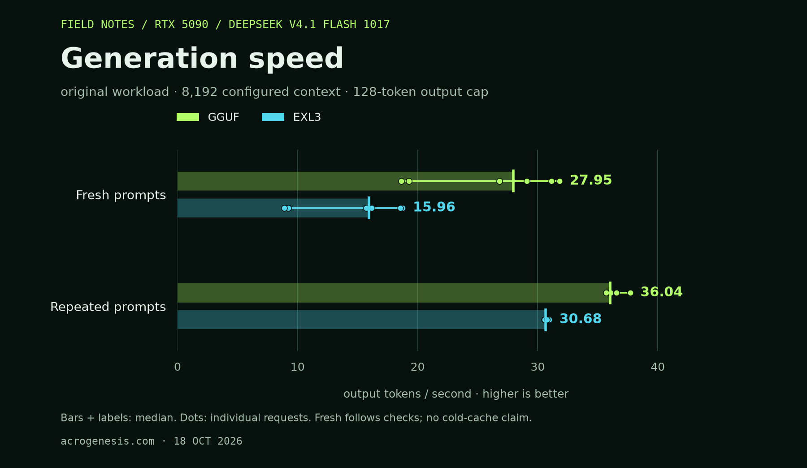
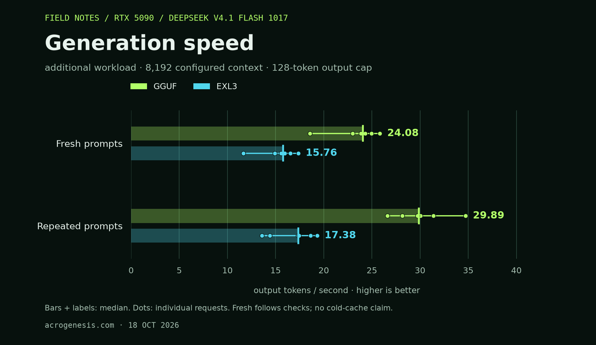
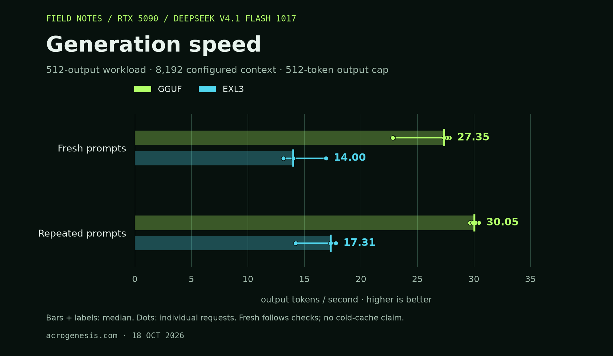
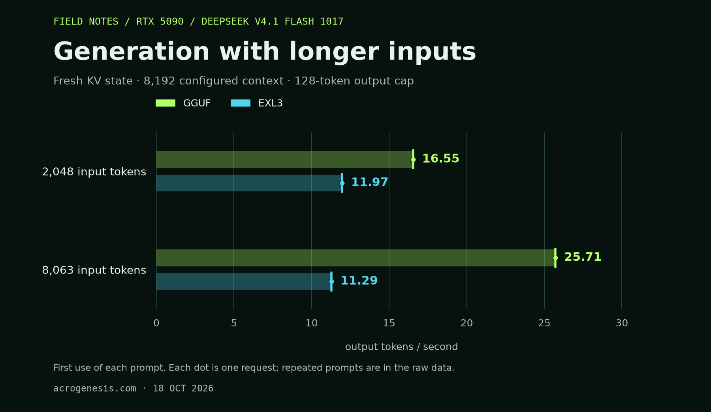
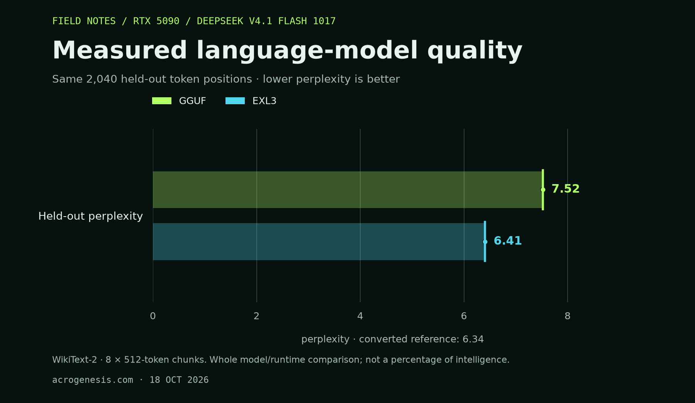

# DeepSeek V4.1 Flash: our GGUF versus EXL3

Our GGUF is faster on this PC. EXL3 stays closer to the reference model on the
held-out text. Both run the 1017 release with all experts retained.

## Generation speed

Two independent sweeps of the original workload, with identical prompt IDs,
30–31 input tokens, 128 output tokens and 8,192 configured context:

| Measurement | Our GGUF | EXL3 |
|---|---:|---:|
| Fresh-prompt generation | 27.95 tok/s | 15.96 tok/s |
| Repeated-prompt generation | 36.04 tok/s | 30.68 tok/s |
| Fresh time to first token | 0.76s | 1.38s |
| Repeated time to first token | 0.68s | 0.77s |
| Original exact-answer checks | 5/8 | 8/8 |



These are medians across six timed requests per phase, three in each process.
The GGUF repeat medians were 36.07 and 35.80 tok/s; its fresh medians were 29.09
and 26.82. EXL3's repeat medians were 30.60 and 30.75, with fresh medians of
16.18 and 15.73. The 30 tok/s threshold is reproducible for repeated requests;
the original fresh-prompt median remains below it.

Each request starts with fresh KV and recurrent state. Expert and Engram caches
can warm, and the fresh phase follows eight answer checks. Those answers differ
between the quants, so the warmup work is not identical. This is a comparison of
the complete model/runtime packages, not an isolated file-format experiment or
a cold-disk benchmark. Both timers count delivered tokens after the first token
through the last token; GGUF uses its HTTP client timer, not its server timer.

The additional workload uses six new topics after 24 answer checks. With the
same 128-token output cap, its larger working set reduces cache reuse:

| Additional workload | GGUF, 18 GiB GPU cache | EXL3, 23 GiB GPU cache |
|---|---:|---:|
| Fresh generation | 24.08 tok/s | 15.76 tok/s |
| Repeated generation | 29.89 tok/s | 17.38 tok/s |
| Fresh first token | 0.95s | 1.37s |
| Repeated first token | 0.75s | 1.32s |



Each row summarizes six requests from one process per model. Both models
reproduced all six token sequences on repetition. The original 36/31 tok/s
result should be read with its workload, rather than as a universal rate.

Using the original three prompts with **512 output tokens**:

| Longer answers | GGUF | EXL3, 23 GiB GPU cache |
|---|---:|---:|
| Fresh generation | 27.35 tok/s | 14.00 tok/s |
| Repeated generation | 30.05 tok/s | 17.31 tok/s |



GGUF uses two independent sweeps; EXL3 uses one. All repeated token sequences
match within their respective runs. GGUF's individual repeat medians were
30.40 and 29.88 tok/s. Longer generations were slower than the 128-output
repeated workload on these prompts.

The default 16/64 GiB configuration measured 22.37 fresh / 23.39 repeated tok/s
on the same 512-output fixture. Both fast sweeps match all 3,241 default output
tokens across 14 requests.

## Longer inputs

Both allocate 8,192 tokens and generate 128 output tokens. The request order is
2,048 inputs, 8,063 inputs, then the same two again with fresh KV state.

| Input / phase | GGUF tok/s | EXL3 tok/s | GGUF first token | EXL3 first token |
|---|---:|---:|---:|---:|
| 2,048 / first use | 16.55 | 11.97 | 23.30s | 53.66s |
| 8,063 / first use | 25.71 | 11.29 | 52.47s | 69.34s |
| 2,048 / repeated | 31.72 | 13.33 | 12.66s | 22.56s |
| 8,063 / repeated | 32.65 | 11.43 | 48.39s | 68.25s |



There is one request per length and phase for each model; caches carry over
between requests. Both repeated outputs match their first-use token sequences.
The synthetic system-design notes test latency and throughput; these long
responses were not scored for answer quality.

ExLlama reserves an extra scheduler token even without a drafter. The initial
8,064-input / 128-output request was rejected as requiring 33 pages in a
32-page cache. The paired measurement leaves that position free in both
runtimes. The rejected request and GGUF's completed 8,064-input run are retained.

## Measured quality

| Same held-out text | Our GGUF | EXL3 |
|---|---:|---:|
| Perplexity, lower is better | 7.520919 | 6.405124 |
| Mean KL to the reference, lower is better | 0.362934 | 0.130094 |
| Agreement with the reference's top token | 77.549% | 85.637% |



Both score the same 2,040 positions from eight 512-token WikiText-2 chunks,
separate from calibration. The paired reference perplexity is 6.335829. EXL3's
perplexity is 1.09% above it; GGUF's is 18.70% above it. These percentages describe
perplexity, not intelligence.

The reference retains native MXFP4 experts with a Q8 dense/Engram conversion.
It is not an exact native forward pass. Saved reference probabilities use
llama.cpp's uint16 encoding; KL omits reference log-probabilities at or below
−16. GGUF uses single-token kernels throughout; EXL3 prefills 257 tokens and
then scores forced continuation tokens. The comparison includes quantization
and backend differences. [Protocol](PROTOCOL.md).

On the separate, frozen 24-question panel, **EXL3 passed 20/24 and GGUF passed
11/24**. Both used the same prompts and 128-token answer cap. This scores exact
answers and instruction compliance: extra explanation, Markdown fences, wrong
capitalization and truncated answers fail. It includes arithmetic, Python,
JSON, extraction and simple logic.

| Check | Expected | GGUF | EXL3 |
|---|---|---|---|
| `483 * 27 - 119` | `12922` | `13022` | `12922` |
| `7**13 % 19` | `7` | Hit the cap before answering | `1` |
| `sum(i for i in range(20) if i % 4 == 0)` | `40` | `48` | `48` |
| `len(set("abracadabra"))` | `5` | `6` | `5` |

This panel captures both wrong answers and formatting failures. Both builds
made arithmetic errors. All questions and unedited responses are retained;
the panel was frozen before either model ran it.

## Memory, storage and use

| Configuration | Our GGUF | EXL3 |
|---|---|---|
| Checkpoint | IQ2_XXS experts; Q8 dense/Engram; BF16 embedding/output | LibertAIDAI EXL3 2.9 bpw; original 1017 Engram tables |
| Model files, decimal GB | 359.32 | 413.91 |
| GPU expert cache in the original speed table | 18 GiB | 24 GiB |
| Pinned RAM expert cache | 84 GiB | 84 GiB |
| Peak dedicated model cgroup, original runs | 91.06 GiB | 88.32 GiB |
| Tested context allocation | 8,192 | 8,192 |
| Local interface | OpenAI-compatible text-chat server | Benchmark/generation harness |

The selected GGUF runs left about 2.4 GiB of device memory free. The EXL3
24 GiB configuration left about 154 MiB. Its additional
task and long-input measurements use 23 GiB with the desktop running. Both
recipes enforce a process memory limit and disallow model swap. The GGUF recipe
caps context at 16K because its full advertised 1M attention mask is absent;
the EXL3 8K profile is not a maximum-context claim.

With **equal 18 GiB GPU / 84 GiB RAM caches**, EXL3 measured **14.85 fresh /
19.64 repeated tok/s** on the original workload, compared with GGUF's
27.95 / 36.04. That is one EXL3 sweep and two GGUF sweeps. EXL3 retained all
802 output tokens from its 24 GiB runs. Equal cache bytes cover different
fractions of the two quantized expert sets.

## What made GGUF faster

The same-day original default run measured 20.72 fresh / 28.32 repeated tok/s.
With the new binary but all additions disabled, the default measured
21.66 / 28.80 and retained every output token. The selected fast profile's
27.95 / 36.04 includes both the following code changes and larger cache budgets:

- Batch three expert-weight uploads before synchronizing, while keeping host
  memory leased until the copies finish.
- Protect already-resident experts needed by the current token before choosing
  eviction victims.
- Remove redundant RAM copies of hot GPU experts. Restore their exact bytes to
  RAM before GPU eviction, freeing host slots for other experts.
- Use an 18 GiB GPU cache, 84 GiB host cache and CUDA's existing graph optimizer.

The weights, routed expert IDs, activation precision and sampler are unchanged.
Both final original-workload sweeps match all 937 baseline output tokens across
14 requests. The full-model runtime check matched 100% of top tokens across
510 positions, with KL rounding to zero against uncached GPU execution. The
final held-out metrics also match the earlier 16 GiB GPU run at every reported
digit. That earlier run already used batched uploads; keep-selected and GPU-only
caching were disabled.
The additions are opt-in; the default remains 16 GiB
GPU / 64 GiB RAM. Cache-aging experiments and larger-cache configurations that
did not improve the result remain in the raw evidence.

A later 88 GiB RAM-cache trial measured 28.93 fresh / 37.86 repeated tok/s,
with identical outputs. It left a minimum of 13.89 GiB available host memory
and peaked at 96.12 GiB in its dedicated cgroup. The selected 84 GiB profile
keeps more desktop headroom and has the repeated, longer-output and quality
validation reported above. One decode thread, eight I/O workers and the tested
cache-aging changes did not improve the selected fresh-prompt result.

To use the selected profile after building the streaming runtime:

```bash
SPEED_PROFILE=fast bash scripts/start.sh iq2
```

Stop with `systemctl --user stop deepseek41-server`. The API remains at
`http://127.0.0.1:5017`. The launcher passed a real OpenAI chat request with
system and user roles, matching the official template and expected token count.
It was stopped after validation; port 5017 is closed.

Measured on an RTX 5090 32 GB, Ryzen 9950X3D, 128 GB DDR5 and Samsung 990 PRO
NVMe on encrypted Btrfs. One sequence, temperature zero, chat mode with thinking
off, no drafter, official encoding, and no simultaneous model workloads. Source revisions, hashes,
commands, outputs and resource measurements accompany each result.

## Evidence and reproduction

- [Paired result manifest](results/20261018-gguf30/comparison-manifest.json),
  [normalized measurements](results/20261018-gguf30/comparison/comparison.json)
  and [EXL3 source receipts](results/20261018-gguf30/exl3-evidence/sources.json).
- [All tuning trials](results/20261018-gguf30/tuning.json),
  [resource samples summarized](results/20261018-gguf30/gguf-resources.json)
  and [validation receipt](results/20261018-gguf30/validation.json).
- [Additional prompts and expected answers](results/20261018-gguf30/fixtures/additional-short.json),
  [GGUF responses](results/20261018-gguf30/gguf-additional-answers.json)
  and [EXL3 responses](results/20261018-gguf30/exl3-additional-answers.json).
- [Launcher verification](results/20261018-gguf30/fast-launcher.json),
  [real chat response](results/20261018-gguf30/fast-chat-endpoint.json)
  and [optional cache settings](patches/README.md#optional-transfer-and-cache-settings).

Regenerate the tables' source data and figures with the recipe's Python
environment (Matplotlib 3.11.2 was used here):

```bash
.venv/bin/python scripts/compare_exl3.py \
  --manifest results/20261018-gguf30/comparison-manifest.json \
  --out results/20261018-gguf30/comparison
```

To repeat the selected speed test with the GPU free:

```bash
systemd-run --user --collect --unit=deepseek41-fast-bench \
  -p MemoryHigh=92G -p MemoryMax=96G -p MemorySwapMax=0 \
  --working-directory="$PWD" \
  env GPU_CACHE_GIB=18 RAM_CACHE_GIB=84 THREADS=16 IO_THREADS=4 \
  LLAMA_MOE_STREAM_UPLOAD_BATCH=3 LLAMA_MOE_STREAM_KEEP_SELECTED=1 \
  LLAMA_MOE_STREAM_GPU_ONLY_GIB=14 GGML_CUDA_GRAPH_OPT=1 \
  python scripts/run_probe.py --profile streaming --variant iq2 \
  --label fast-repeat --fixture results/20261017T210718Z-iq2-streaming/fixture.json
```

The CUDA build and host-cache/file tests passed. Other GPU backends were not
tested. No new weights were produced by this runtime tuning.
