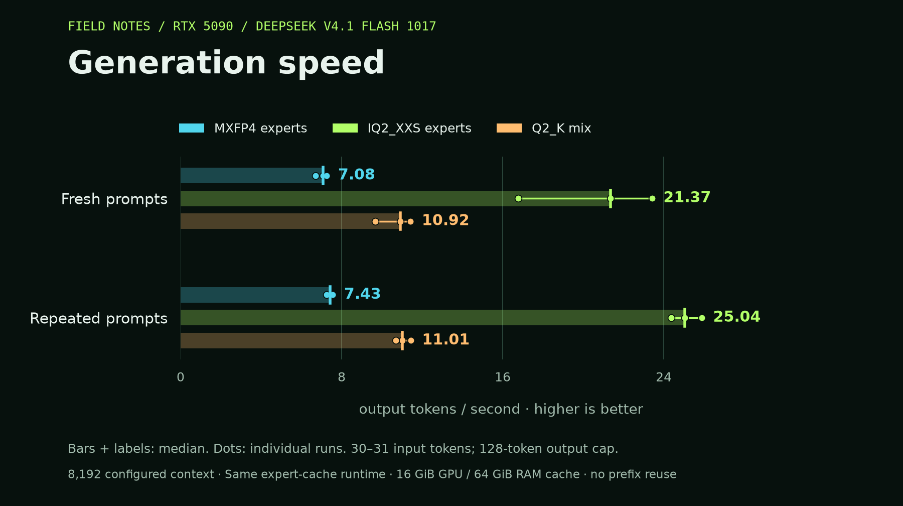

# DeepSeek V4.1 Flash 1017 on a 5090

**21.37 tok/s on an RTX 5090 32 GB and 128 GB RAM.** This recipe streams
[DeepSeek's exact 1017 release](https://huggingface.co/deepseek-ai/DeepSeek-V4.1-Flash-1017)
from a Samsung 990 PRO SSD, using a pinned llama.cpp runtime with a demand-only
expert cache: 16 GiB on the GPU and 64 GiB in RAM.

[Download the quant on Hugging Face](https://huggingface.co/acrogenesis/DeepSeek-V4.1-Flash-1017-IQ2_XXS-GGUF).

The custom **359.32 GB GGUF** uses IQ2_XXS routed experts, Q8 dense/Engram weights
and BF16 embedding/output weights. It retains all 384 experts per layer and both
Engram tables. The expert quant starts from native MXFP4 weights in a verified
converted reference. Every non-expert tensor payload is unchanged.

| Weights | Fresh tok/s | Repeated tok/s | Fresh first token |
|---|---:|---:|---:|
| Our IQ2_XXS experts / Q8 dense + Engram | **21.37** | **25.04** | **1.12s** |
| Public Q2_K mix | 10.92 | 11.01 | 3.67s |
| MXFP4 experts / Q8 dense + Engram | 7.08 | 7.43 | 5.02s |



Medians of three runs per phase, 30–31 input tokens, 128 output tokens, 8K
configured context, one slot and no KV prefix reuse. Fresh prompts follow eight functional checks; these
are not cold-disk measurements. All three use the same cache budgets. The CPU is
a Ryzen 9950X3D.

Quality changed: held-out perplexity was **7.57** for our quant, **12.65** for public
Q2 and **6.34** for the converted reference, on 2,040 scored positions. Lower is
better. Our quant passed 5/8 exact-answer checks: two failures included the right
number with extra explanation, and one exhausted the 64-token limit. Reference
and public Q2 passed 8/8 and 7/8. Full measurements, uncertainty, failed answers
and repeated-output differences are in [RESULTS.md](RESULTS.md).

This runtime supports text chat here and caps context at **16K**. It does not
implement the full advertised 1M attention mask. Tool calls, vision and DSpark
are not enabled. A 16K request completed after **6 minutes to first token**,
returning the correct code with extra words and failing the exact-answer check.
The default remains 8K. [VALIDATION.md](VALIDATION.md) links the checks;
[PROTOCOL.md](PROTOCOL.md) records the measurement method.

## Build and download

Requires Linux, CUDA 12.9, GCC 14, CMake, Ninja, Python and Hugging Face CLI (`hf`).

To run the published custom quant without downloading the baseline or converting:

```bash
git clone https://github.com/acrogenesis/deepseek-v41-flash-recipe-kit
cd deepseek-v41-flash-recipe-kit
bash scripts/build.sh streaming
python scripts/download.py --variant iq2
bash scripts/start.sh iq2
```

The ten shards total 359.32 GB. Keep at least 50 GiB of disk free beyond the
download. The downloader checks each SHA256 against the conversion manifest.

For the public Q2 baseline and the full comparison workflow:

```bash
bash scripts/build.sh
python scripts/download.py
bash scripts/build.sh streaming
```

The streaming build is experimental. Its [patch provenance](patches/README.md) and Linux file-I/O checks are included. Keep build work separate from speed measurements.

For calibration data, source checks and plotting:

```bash
uv venv
uv pip install --python .venv/bin/python -r requirements.txt -e work/upstream/llama.cpp/gguf-py
.venv/bin/python scripts/prepare_data.py
.venv/bin/python scripts/prepare_mixed_calibration.py
.venv/bin/python scripts/check_reference_source.py
```

The optional reference download is `python scripts/download.py --variant reference`
(508 GB). It retains native MXFP4 expert weights and converts dense/Engram weights
to Q8, with BF16 embedding/output weights retained. This is the source used for custom quantization; the public Q2_K baseline is not requantized. See the precision and disk-budget notes in the protocol.

## Build and measure the custom quant

After building both runtimes and preparing the data above:

```bash
python scripts/download.py --variant reference
.venv/bin/python scripts/check_reference_source.py --local-reference --layers 0 7 14 21 28 35 39
.venv/bin/python scripts/check_engram_source.py
systemd-run --user --collect --unit=deepseek41-conversion-campaign \
  -p Nice=5 -p MemoryHigh=72G -p MemoryMax=80G -p MemorySwapMax=0 \
  --working-directory="$PWD" \
  "$PWD/.venv/bin/python" "$PWD/scripts/campaign.py" --resume
```

This runs reference quality measurement, calibration, IQ2_XXS expert conversion,
paired quality comparisons and speed tests. It retains every expert and checks
that all non-expert tensor payloads stay byte-identical. Calibration coverage is
recorded; any unseen expert uses the pinned quantizer's standard uniform weighting,
with its ID listed in the conversion manifest. Downloads and conversion
finish before throughput measurements start. The GPU must be free of other model
servers.

The full working set needs about **1.13 TB** of disk for the baseline, reference
and custom output, plus scratch space. Conversion takes hours on this CPU; the
one-layer pilot took three minutes with 24 threads. Measurements are in `RESULTS.md`, with raw evidence and charts under `results/`.

Check progress with `python scripts/status.py`. After successful conversion,
`bash scripts/start.sh iq2` serves the verified custom artifact. The `--resume`
option preserves completed campaign stages and failed logs; it refuses to reuse
completed stages under different source pins.

## Run the first probe

```bash
systemd-run --user --collect --unit=deepseek41-baseline-probe \
  -p MemoryHigh=72G -p MemoryMax=80G -p MemorySwapMax=0 \
  --working-directory="$PWD" \
  python "$PWD/scripts/run_probe.py" --profile baseline
```

Add `--wait-download` only when `deepseek41-download.service` is running. Results include prompts, token IDs, responses, timings, server logs, physical reads and memory/power samples. The probe stops its server after completion.

For the paired streaming run, pass `--profile streaming --fixture /absolute/path/to/baseline/fixture.json` to the same command. Both runs use the same 8K context and prompt IDs. Fresh prompts and repeated prompts are reported separately.

The eight functional checks measure exact answers on a small task panel. They do not measure quantization loss. The conversion campaign compares held-out distributions against the MXFP4/Q8 reference, as described in the protocol.

## Serve

```bash
bash scripts/start.sh iq2
```

The API listens on `http://127.0.0.1:5017`. The launcher uses the demand-only expert cache with 16 GiB GPU and 64 GiB RAM budgets. Stop it with `systemctl --user stop deepseek41-server`.

The streaming recipe disables wave preloading after it failed a synthetic
correctness test. Demand loading passed the small cache tests, real-dimension
expert eviction tests and the full-model checks linked in VALIDATION.md.

Use `python scripts/chat.py 'Explain how this model streams experts from SSD.'`
for text chat with the official prompt encoding. The custom conversion embeds a
text-chat template checked byte for byte against the official V4.1 encoder on ten
message histories. The baseline and reference use the same template as a launch
override. Embedding preserves every tensor byte and all other metadata, including
the tokenizer. The template supports system, user and
assistant messages; tool calls are rejected and thinking mode is disabled. Both
the baseline and custom artifact passed real OpenAI chat completions with a system
prompt, the exact expected answer and matching input-token counts.
The benchmarks use the official encoder and raw completion endpoint.

The launcher defaults to 8K and allows `CONTEXT=16384 bash scripts/start.sh iq2`
when the server is stopped. The custom 16K request completed but failed the
exact-answer check described above. Vision and DSpark speculation are not enabled.

## Sources

Why GGUF here: [Sybil's published EXL3 configuration](https://github.com/sybil-solutions/dsv41-flash-offload#host-requirements-exact-measured-on-d119)
pins 190.5 GiB of routed experts in RAM and specifies a 256 GiB host. This PC has
128 GB. The GGUF runtime used here reads experts from SSD into bounded caches.
That is a runtime and memory-budget choice; EXL3 was not benchmarked on this PC,
and these results do not establish an advantage over a different EXL3 runtime.

- [Exact DeepSeek release](https://huggingface.co/deepseek-ai/DeepSeek-V4.1-Flash-1017)
- [V4.1 support PR](https://github.com/ggml-org/llama.cpp/pull/28696)
- [JigSawPT's 5090 streaming report](https://github.com/JigSawPT/deepseek-v41-flash-on-5090)
- [Crow](https://github.com/nibor1896/Crow)
- [Sybil's EXL3 offload recipe](https://github.com/sybil-solutions/dsv41-flash-offload), which needs at least 256 GiB RAM in its published configuration

The `third_party` and `patches` directories preserve upstream source attribution and licenses. No weights are included in Git.
