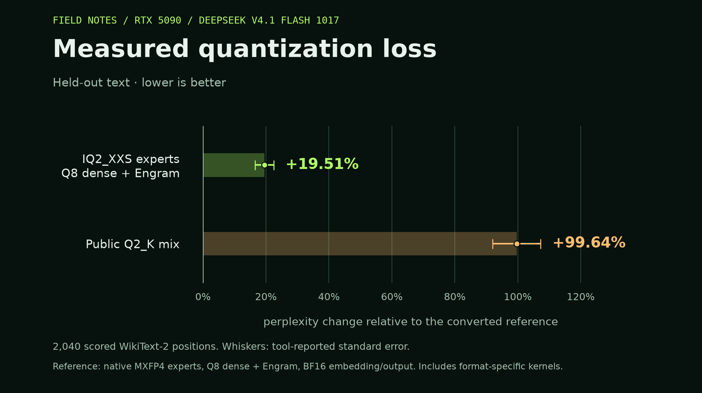

# DeepSeek V4.1 Flash 1017 on RTX 5090

Measured on one RTX 5090 32 GB, Ryzen 9950X3D, 128 GB RAM and Samsung 990 PRO SSD.

## Generation speed

| Weights | Fresh tok/s | Repeat tok/s | Fresh TTFT | Functional checks |
|---|---:|---:|---:|---:|
| MXFP4 experts / Q8 dense + Engram | 7.08 | 7.43 | 5.02s | 8/8 |
| IQ2_XXS experts / Q8 dense + Engram | 21.37 | 25.04 | 1.12s | 5/8 |
| Public Q2_K mix | 10.92 | 11.01 | 3.67s | 7/8 |

Medians of three requests per phase, with 30, 31, 31 input tokens and a 128-token output cap; 8,192 configured context, one slot, official chat encoding, temperature zero, no KV prefix reuse. Fresh prompts follow eight functional checks. No cold-disk claim. All three use the same demand-only expert cache: 16 GiB GPU budget, 64 GiB pinned RAM and four direct-I/O workers. Download and conversion jobs finished before these timings. The separate eight-task panel requires exact answers and uses a 64-token output cap; extra explanation counts as a failure.

## Measured quality

| Weights | Held-out perplexity | PPL change | Top-choice agreement | Mean KL |
|---|---:|---:|---:|---:|
| MXFP4 experts / Q8 dense + Engram | 6.3358 | reference | reference | reference |
| IQ2_XXS experts / Q8 dense + Engram | 7.5721 | +19.512% ± 2.942% | 76.863% | 0.365186 |
| Public Q2_K mix | 12.6486 | +99.636% ± 7.613% | 62.745% | 0.983094 |

2,040 scored positions from 8 held-out WikiText-2 chunks at context 512. Lower perplexity and KL are better. The ± values are tool-reported standard errors for the paired PPL ratios. The table uses the paired reference reconstructed from saved probabilities; the standalone reference PPL was 6.3430. The tool stores compressed log-probabilities and omits tiny-probability KL terms; [PROTOCOL.md](PROTOCOL.md) records that approximation. These metrics measure distribution changes on this sample; they are not a percentage of intelligence retained. The reference retains native MXFP4 expert weights and BF16 embedding/output weights, with other dense/Engram weights converted to Q8. The comparison includes the kernels used by each weight format; it does not establish parity with the exact native forward pass.

Calibration used 128 separate training chunks of 512 tokens. Observed 46,020/46,080 expert-tensor entries. The remaining 60 entries used the quantizer's standard unit importance weights; their IDs are recorded in the conversion manifest. Only routed experts were quantized; every expert remains. SHA256 checks confirmed that all non-expert tensor payloads, including both Engram tables, are unchanged.

The custom quant contains 359.32 GB of GGUF shards. The large Engram tables remain on SSD. The runtime does not implement the full advertised 1M attention mask; this recipe caps context at 16K.

## Failed functional checks

- MXFP4 experts / Q8 dense + Engram: all eight passed
- IQ2_XXS experts / Q8 dense + Engram: `remaining`: '84 - 6*9 = 84 - 54 = 30\n\n30' (expected '30'); `percentage`: "Let's go step by step.\n\n1. Start with the price: 240  \n2. Apply a 15% discount:  \n   Discount = 240 × 0.15 = 36  \n   Price after discount = 240 − 36 = 204  \n\n3. Add 10% tax:" (expected '224.4'); `python`: 'TC: The expression sums the squares of odd numbers from 1 to 5.\n\nOdd numbers: 1, 3, 5\nSquares: 1, 9, 25\nSum: 1 + 9 + 25 = 35\n\n35' (expected '35')
- Public Q2_K mix: `json`: '{"count": 2}' (expected {'count': 3})

## Runtime comparison

Both runtimes include the same reviewed attention and CUDA fixes. The no-cache runtime was also tested with GPU operation offload forced for single-token generation.

| Q2_K runtime | Fresh tok/s | Repeat tok/s |
|---|---:|---:|
| No cache, CPU experts | 1.99 | 2.16 |
| No cache, GPU operation offload | 1.59 | 1.69 |
| GPU expert cache | 10.92 | 11.01 |

[Runtime comparison chart](results/quantization-comparison/runtimes/generation-speed.png)

The separate cache check matched all 508 single-token top choices against uncached GPU arithmetic, with mean KL rounding to zero. CPU versus GPU arithmetic differed, agreeing on 91.339% of top choices with mean KL 0.031168. [Saved backend comparison](results/validation/backend-drift.json).

## Repeated outputs

| Model/runtime | Identical repeated completions |
|---|---:|
| MXFP4 experts / Q8 dense + Engram | 3/3 |
| IQ2_XXS experts / Q8 dense + Engram | 3/3 |
| Public Q2_K mix | 0/3 |
| Q2_K, no cache / CPU experts | 3/3 |
| Q2_K, no cache / GPU offload | 3/3 |

Temperature and seed were fixed, prompts matched, and the server reported zero KV prefix reuse. Changed completions mean repeat-speed differences cannot be assigned solely to cache warming. [Saved token and context audit](results/validation/probe-repeat-consistency.json).

## Serving checks

- Full custom-model cache check passed on 510 batched positions: 100.000% top-choice agreement, mean KL -0.000001, PPL ratio 1.000002 against uncached GPU arithmetic. [Evidence](results/validation/custom-runtime.json).
- Custom 16K request completed with 16,128 input tokens, but failed the exact-answer check. It returned 'tacking down the code: K7M2R9.' instead of exactly 'K7M2R9'. First token: 360.5s (6.0 minutes). This single request is functional evidence, not a broad context or throughput benchmark. [Evidence](results/20261017T214241Z-iq2-context16k/context-smoke.json).
- OpenAI chat endpoint passed with 8,192 configured context: exact `DEEPSEEK_READY`, official template and matching input-token count. [Evidence](results/validation/chat-endpoint-iq2.json).

## Raw evidence

- [20261017T210406Z-reference-streaming](results/20261017T210406Z-reference-streaming/probe.json)
- [20261017T210718Z-iq2-streaming](results/20261017T210718Z-iq2-streaming/probe.json)
- [20261017T210838Z-streaming](results/20261017T210838Z-streaming/probe.json)
- [20261017T165950Z-mxfp4-q8-reference](results/20261017T165950Z-mxfp4-q8-reference/quality.json)
- [20261017T205714Z-iq2-vs-mxfp4-q8](results/20261017T205714Z-iq2-vs-mxfp4-q8/quality.json)
- [20261017T205910Z-q2-vs-mxfp4-q8](results/20261017T205910Z-q2-vs-mxfp4-q8/quality.json)
- [20261017T212430Z-baseline](results/20261017T212430Z-baseline/probe.json)
- [20261017T211053Z-gpu-offload](results/20261017T211053Z-gpu-offload/probe.json)
